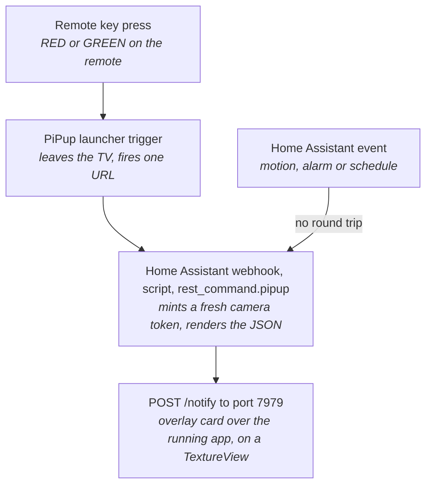

# PiPup hardening fork

This branch (`pipup-hardening`) is a fork of the abandoned
[rogro82/PiPup](https://github.com/rogro82/PiPup) that fixes the three faults
which made it unusable on a Sony BRAVIA — unreliable autostart, popups that
would not draw over a running app, and 10+ second startup — and then adds
remote-key interaction, launcher triggers and a styled card.

Every measurement and behaviour described here was observed on the device.
Where something was not tested, it says so.

## What it was forked to fix

Upstream has not been touched since 2019 and no longer builds: jcenter is gone
and it applies the removed `kotlin-android-extensions` plugin. Making it
compile was the precondition for everything below.

| Fault | Cause | Fix | Result on the device |
| --- | --- | --- | --- |
| Popups stopped appearing after a TV power cycle | The service relied on `BOOT_COMPLETED` alone, which Android TV delivers late or not at all | Boot receiver plus a watchdog `JobService` that restarts the service, and a battery-optimisation whitelist | Survives power cycles; see the force-stop caveat below |
| No video popup while another app was playing | `SurfaceView` punches a hole through the compositor, so the playing app's own video surface won | `TextureView`, which composites inside the view hierarchy and therefore draws on top | Draws over fullscreen playback with no stop command first |
| 10+ seconds to first frame | Cold ExoPlayer decoder negotiation plus default load-control buffering | An MJPEG path that needs no decoder, software-decoder preference, and a trimmed `DefaultLoadControl` | ~245 ms over a running HLS stream; ~1.3 s for the doorbell MJPEG |

The third fix makes the second one moot in practice: the Home Assistant
scripts used to send a stop or quit command to the TV before every popup, and
that step is gone.

## How a popup reaches the screen



The long way round on the left is not an accident. A popup URL carries a
rotating camera token, so a key press cannot call the TV directly — it has to
leave the TV, reach Home Assistant and come back with a token that is still
valid.

## Remote key actions

A popup can listen to the TV remote. `dismissOnKey: true` closes it on any
key; a `keys` map binds individual keys to one of five actions.

| Action | What it does |
| --- | --- |
| `dismiss` | Closes the popup |
| `release` | Leaves the popup up and hands the remote back to the app underneath |
| `{launch: <package>}` | Starts an app |
| `{url: <address>}` | Fires a GET and forgets it — aimed at Home Assistant webhooks |
| `{media: {…}}` | Swaps the camera inside the popup without rebuilding it |

The rule that matters: **a popup with no `keys` never drops
`FLAG_NOT_FOCUSABLE`**, so an ordinary notification cannot steal the remote
from whatever is playing. Once a popup is interactive the opposite applies —
unmatched keys are swallowed rather than passed through — so always pair a
`keys` map with `release` or `dismissOnKey: true` to leave a way out.
`release` also detaches the key handler, which makes it an exit rather than a
toggle: keys bound after it stop working.

Launching an app from the background works because holding
`SYSTEM_ALERT_WINDOW` exempts the app from the API 29
background-activity-start ban.

Keycodes measured on a Sony BRAVIA, not guessed: DPAD_UP/DOWN/LEFT/RIGHT
19–22, DPAD_CENTER 23, BACK 4, PROG_RED/GREEN/YELLOW/BLUE 183–186, MEDIA_PLAY
126, MEDIA_PLAY_PAUSE 85, number keys 8–16. HOME and VOLUME never reach the
app — the TV intercepts them — so they cannot be mapped. The colour buttons do
reach apps on this set, contrary to the usual expectation, and nothing else
competes for them. `OverlayView` logs every keycode it sees, which is how to
find out what a given remote emits.

## Launcher triggers

A remote key cannot call Home Assistant by itself, so PiPup publishes
no-display launcher aliases: activities that show up as apps in the TV
launcher, fire one URL and exit without drawing anything. Button Mapper binds
a key to "launch app", and the press becomes an HTTP call. Firing one has been
verified not to disturb a playing app.

Each alias is one entry: an activity name, the label it shows in the launcher,
and the URL it fires. A camera button looks like this —

| Alias | Shows as | Calls |
| --- | --- | --- |
| `.TriggerFrontDoor` | Front Door Cam | Webhook `pipup_front_door` |

The indirection exists because a popup URL carries a rotating camera token.
The key press has to pass through Home Assistant so a fresh one gets minted.

Past two or three buttons, a webhook each gets tedious. The alternative is one
**generic webhook that names its automation in the query string**
(`?id=automation.watch_tv`), so a new button needs no Home Assistant changes at
all — only a new trigger URL. If you do that, the webhook id is long and random
on purpose: it is unauthenticated, so **the id is the credential**. Make it
`local_only` and have it refuse anything that is not an existing `automation.*`,
or any device on the LAN can run any automation you own.

Home Assistant owns the trigger URLs and re-pushes them with
`rest_command.pipup_triggers` on start and whenever the TV turns on, so a
cleared app or a reinstall heals itself without adb. Button Mapper's own
config is not writable over adb — no root on a retail Sony — so the key
bindings are the one part that has to be set by hand in its UI.

## Appearance

The popup was a flat rectangle. It now takes nine optional fields, every one
of which defaults to the old look, so a caller that omits them gets
byte-identical behaviour.

| Field | Type | Default | Effect |
| --- | --- | --- | --- |
| `cornerRadius` | px | `0` | Rounds the card and clips the media to the same radius |
| `borderWidth` | px | `0` | Stroke around the card |
| `borderColor` | `#AARRGGBB` | transparent | Stroke colour |
| `backgroundColorEnd` | `#AARRGGBB` | unset | Turns `backgroundColor` into a top-to-bottom gradient |
| `elevation` | px | `0` | Drop shadow |
| `showProgress` | boolean | `false` | A bar along the bottom that depletes over `duration` |
| `progressColor` | `#AARRGGBB` | `titleColor` | Bar colour |
| `icon` | URL | none | Image placed before the title |
| `iconSize` | px | `48` | Icon size |

Neither the progress bar nor the icon is a new view, and that is deliberate —
every attempt to add one broke the layout. The bar is a `ClipDrawable` layer
inside the card's background, animated with an `ObjectAnimator` on its `level`
from 10000 to 0 and inset by `cornerRadius / 2` so it does not poke out of the
rounded corners. The icon is set with `setCompoundDrawablesRelative` on the
title.

## Choosing a video source

The single biggest lever on how a popup feels is what you point it at, not any
setting on the card. `mediaType` picks one of four paths:

| `mediaType` | What it is | Video decoder | Trade |
| --- | --- | --- | --- |
| `image` | One still, refetched per popup | none | Fastest and least breakable. Often all a notification needs. |
| `mjpeg` | `multipart/x-mixed-replace`, what Home Assistant's `camera_proxy_stream` serves | none | Added by this fork. Live motion with no decoder negotiation, paid for in bandwidth — every frame is a whole JPEG. |
| `video` | Anything ExoPlayer plays, usually HLS | yes | Cheapest for sustained video, but pays decoder setup and segment buffering before the first frame. |
| `web` | A URL in a WebView | WebView's own | The escape hatch: WebRTC, a dashboard, any player of its own. Slowest to first frame, and needs `javaScriptEnabled`. |

**For cameras, start at `mjpeg` and move only if it disappoints.** Avoiding the
decoder is most of what took first frame from 10+ seconds to roughly one here,
and it sidesteps a whole class of firmware decoder bugs — including the one on
this TV that needed the software-decoder fallback. Use `image` when a still will
do: a snapshot answers "who is at the door" as well as video does, and it is the
most reliable path by a wide margin.

### A slow popup is usually the stream, not the camera

From the two cameras here, all over `mjpeg`:

| Stream | Result |
| --- | --- |
| Doorbell, the camera's default Home Assistant stream | ~1.3 s to first frame |
| Garage, ONVIF **substream** | ~3.8 s to first frame, ~14 fps |
| Garage, the same camera's **main stream** | ~4 s *per frame*, ~0.2 fps, and it fails Home Assistant's stream parser outright |

The striking part is that the substream is the same 1280x720 as the main
stream and still an order of magnitude better, so resolution was not what made
the difference. Home Assistant hides ONVIF substreams by default with
`disabled_by=integration`, which means the better stream is often sitting there
disabled while the camera gets the blame.

Worth working through in this order:

1. **Try `image` first.** If a still is slow, the problem is the camera or the
   network, and no `mediaType` will fix it.
2. **Look for a disabled substream entity** on the camera's integration before
   concluding the camera is slow. Enable it and point `mjpeg` at that.
3. **Compare the two Home Assistant endpoints by hand** — `camera_proxy` for a
   snapshot against `camera_proxy_stream` for MJPEG. Fetching each with `curl`
   tells you whether the camera or the TV is the slow half.
4. **If the camera only speaks WebRTC**, `web` works, but expect seconds rather
   than milliseconds. It is what the garage camera used before the substream
   was found.

Not tested here, but worth knowing if that runs out: go2rtc, bundled with
recent Home Assistant, can restream most things as MJPEG, which would put an
awkward camera back on the fast path.

## Home Assistant use cases

Everything reaches the TV through one `rest_command.pipup`, which POSTs to
`http://<tv>:7979/notify`. Scripts and automations pass only the fields they
care about; the optional ones are appended by a Jinja loop, so a caller that
omits them sends exactly the JSON it used to.

| Use case | Shape of the popup |
| --- | --- |
| Doorbell press or motion | Camera MJPEG, no `keys`, auto-expires |
| Garage camera on a remote key | Camera MJPEG, `keys` for dismiss / release / launch |
| Watch TV and Unwatch TV scenes | No popup — launcher trigger straight to an automation |
| Washer done, bin day, someone arrived home | Text only, short duration, out of the way |
| Smoke, CO or intruder alarm | `duration: 0`, one key bound to `dismiss` |
| Intercom with an action | Camera plus `{url: …}` on a key, hitting a webhook that unlocks |
| Walk through the cameras | `{media: …}` on LEFT and RIGHT, swapping the feed in place |

### The doorbell: notify without stealing the remote

No `keys`, so the popup never takes focus from whatever is playing. It expires
on its own.

```yaml
sequence:
  - action: rest_command.pipup
    data:
      title: Front Door
      message: Motion detected
      position: 1
      mediaType: mjpeg
      width: 640
      url: >-
        http://homeassistant.local:8123{{ state_attr(camera, 'entity_picture')
        | replace('/api/camera_proxy/', '/api/camera_proxy_stream/') }}
      cornerRadius: 28
      borderWidth: 2
      borderColor: '#4D6C7A99'
      backgroundColor: '#F21C2029'
      backgroundColorEnd: '#F2101217'
      elevation: 24
      showProgress: true
      progressColor: '#4DA3FF'
```

### The garage camera: a popup you can act on

Adding `keys` makes the popup take the remote for its duration, which is the
point here — the camera app is one press away.

```yaml
      keys:
        BACK: dismiss
        DPAD_UP: release
        DPAD_DOWN:
          launch: com.example.yourcameraapp
```

### An alarm that will not go away by itself

`duration: 0` never schedules the removal, so the popup stays until `/cancel`
or another popup replaces it. Bind exactly one key so it cannot be cleared by
a stray press.

```yaml
      duration: 0
      title: Smoke detected
      message: Hallway
      borderColor: '#FFE5484D'
      keys:
        BACK: dismiss
```

### An action on a key

The `url` action is fire-and-forget, which is exactly the shape of a Home
Assistant webhook. Bind it to a key and the popup becomes a one-press
confirmation.

```yaml
      keys:
        DPAD_CENTER:
          url: http://homeassistant.local:8123/api/webhook/unlock_front_door
        BACK: dismiss
```

A useful habit for any of these: gate the automation on an `input_boolean` so
popups stay quiet during a film. Worth knowing too that a popup renders fine
over the TV's screensaver, but with the display off it is created and never
shown — PiPup does not wake the TV, and deliberately so.

## Which TVs this works on

Nothing in the code is Sony-specific. `minSdk` is 24 and `targetSdk` 30, the
overlay uses the standard `TYPE_APPLICATION_OVERLAY` behind
`SYSTEM_ALERT_WINDOW`, and the keycodes are ordinary Android `KeyEvent`
constants. It should run on most Android TV hardware — an Nvidia Shield, a
Chromecast with Google TV, a generic MediaTek set, and in principle Fire TV.

It has only been tested on one device, though: a Sony BRAVIA 4K UR2 on Android
10, MediaTek SoC. What is most likely to differ elsewhere:

- **The remote.** The colour buttons are the best keys to map on this Sony
  because nothing else competes for them, but many Android TV remotes have
  none. Which keys the TV swallows before the app sees them — HOME and VOLUME
  here — is firmware-dependent too. `OverlayView` logs every keycode it
  receives, so the answer for any given remote takes about a minute to find.
- **Launcher triggers need a launcher that lists them.** The aliases are
  leanback launcher entries; where a launcher hides them, Button Mapper can
  launch the activity directly instead.
- **Granting the overlay permission.** `adb shell appops set …
  SYSTEM_ALERT_WINDOW allow` works here; some devices want it granted through
  Settings.
- **The software-decoder fallback** exists because this MediaTek firmware
  misreports `OMX.google.h264.decoder`. It is harmless anywhere else and
  unnecessary on most.

The Home Assistant side is device-agnostic apart from the TV's address.

## Building and installing

There is no JDK or Android SDK on the machine this is developed from, so
nothing builds locally. Push to the fork, let the GitHub Actions workflow
produce the APK, download the artifact, `adb install -r`.

Two things in the build are load-bearing and look like mistakes:

- **`app/debug.p12` is committed on purpose.** Without it each CI runner
  generates its own debug keystore, consecutive builds get signed by different
  keys, and the install fails with `INSTALL_FAILED_UPDATE_INCOMPATIBLE`. It
  was generated with openssl rather than keytool, there being no JDK to run
  keytool with. It is a debug key only.
- **The workflow pins `packages: ''` on `android-actions/setup-android`.**
  That action otherwise installs Google's legacy `tools` SDK package, which
  was removed around September 2026 and now fails the build before Gradle
  starts.

Home Assistant owns everything else, but five settings live on the TV and
cannot be pushed: PiPup's overlay permission and its battery-optimisation
whitelist (both adb), Button Mapper's key bindings and its accessibility
toggle, and adb debugging itself.

adb does not survive a reboot here. Network debugging switches itself off, and
turning it back on revokes the authorisation, so the TV has to show the RSA
prompt again — tick "always allow". If `adb connect` reports "No route to
host" while port 5555 is provably open, the local adb server is stale and
`adb kill-server` fixes it.

## Gotchas worth remembering

The ones that cost real time, roughly in order of how long they took to find:

- **A `TextureView` that is not `VISIBLE` never creates its `SurfaceTexture`.**
  ExoPlayer then renders to a placeholder surface and shows nothing, silently.
  This looked like a decoder problem for a long while; a screenshot of the
  black box is what gave it away.
- **A bare `View` returns the spec size from `getDefaultSize()` for
  `AT_MOST`**, so `wrap_content` behaves identically to `match_parent`. Three
  attempts at the progress bar died here before it became a background
  drawable instead.
- **Editing `rest_commands.yaml` needs `rest_command.reload`.** Reloading
  scripts is not enough — Home Assistant keeps rendering the old payload
  template, and the symptom is indistinguishable from the app ignoring the new
  fields. Render the payload with `POST /api/template` before suspecting the
  APK.
- **`MediaCodecInfo.softwareOnly` reports false for
  `OMX.google.h264.decoder`** on this firmware, so preferring a software
  decoder needs a name-prefix fallback. Without it the preference is a no-op.
- **`am force-stop` cancels scheduled jobs**, so a force-stopped app cannot be
  revived by any watchdog until it is launched once by hand.
- Smaller ones: `--` inside an XML comment breaks the manifest merger;
  cleartext `http://` media URLs need `usesCleartextTraffic` once
  `targetSdk >= 28`; and `javaScriptEnabled` is off by default, so `web`
  popups render blank until it is set.
